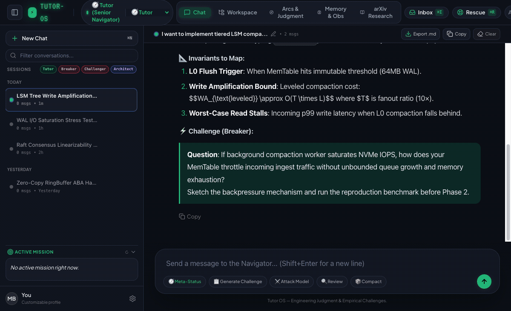

# Tutor OS — Visual Showcase & Portfolio Artifacts

Interactive cognitive harness and local AI coding tutor built for progressive overload.

[](tutor_os_demo.mp4)

---

## 💎 Generated Portfolio Media Pack

All assets have been rendered directly from the live Tauri / Web frontend cockpit with full typographic hierarchy, active theme skins, and live capability graphs:

| Asset | Preview | Resolution / Format | Core Architectural Concept |
| :--- | :--- | :--- | :--- |
| **Full Animated Showcase** | [`ai_code_tutor_os_showcase.gif`](ai_code_tutor_os_showcase.gif) | 1200×731 (Smooth 10fps loop, 613 KB) | Full interactive loop: Inverted pyramid prompt → Capability verification → Auditable disk memory → Multi-theme cockpit |
| **High-FPS Demo Clip** | [`tutor_os_demo.gif`](tutor_os_demo.gif) | 1200×750 (810 KB) | Dynamic session timeline, active Breaker persona, and capability progression |
| **Portfolio Video Stream** | [`tutor_os_demo.mp4`](tutor_os_demo.mp4) | 1280×800 H.264 (354 KB) | Native 30fps web-ready MP4 video for personal portfolio / README / Twitter demo |
| **01. Chat & Inverted Pyramid** | [`01_chat_cockpit.png`](01_chat_cockpit.png) | 1440×900 PNG | Phase 1 Macro Topology & Named Skeletons (no autocomplete spoon-feeding) |
| **02. Capability Arcs** | [`02_capability_arcs.png`](02_capability_arcs.png) | 1440×900 PNG | Empirical verification goals backed by reproducible benchmarks |
| **03. 3-Layer Auditable Memory** | [`03_memory_timeline.png`](03_memory_timeline.png) | 1440×900 PNG | L1 Traces → L2 Audited Facts → L3 Synthesis (Disk-backed, no vector DB) |
| **04. Workspace File Tree** | [`04_workspace_tree.png`](04_workspace_tree.png) | 1440×900 PNG | Embedded Neovim-ready explorer, project slugs, and Synthwave theme |
| **05. Adversarial Hacker Mode** | [`05_hacker_matrix.png`](05_hacker_matrix.png) | 1440×900 PNG | Matrix theme with JIT In-Turn Breaker & Challenger active |
| **06. Dracula Theme Mode** | [`06_dracula_theme.png`](06_dracula_theme.png) | 1440×900 PNG | High-contrast pedagogical review mode with living architecture library |

---

## 🚀 How to Embed in your README or Portfolio

### Option A: Clean Markdown Video/GIF Banner
```markdown
<p align="center">
  
</p>
```

### Option B: Side-by-Side Dual Feature Callouts
```markdown
| Inverted Pyramid Cockpit | 3-Layer Auditable Memory |
| :---: | :---: |
|  |  |
```
